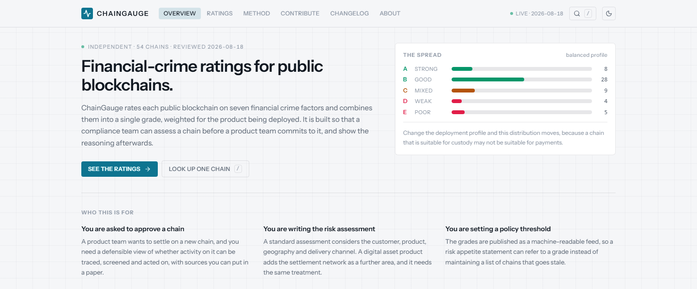
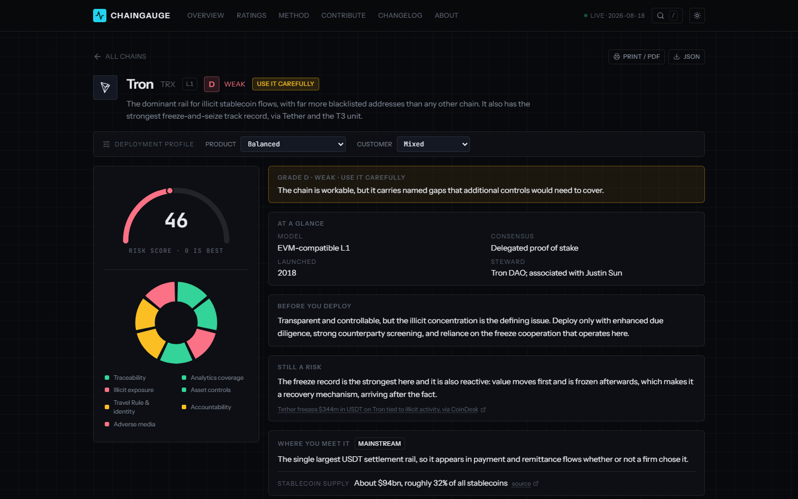
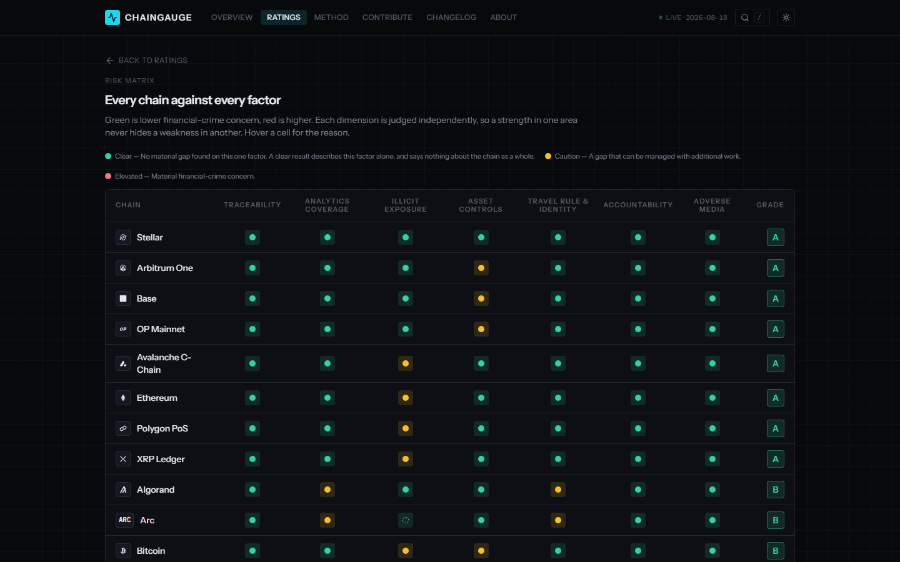
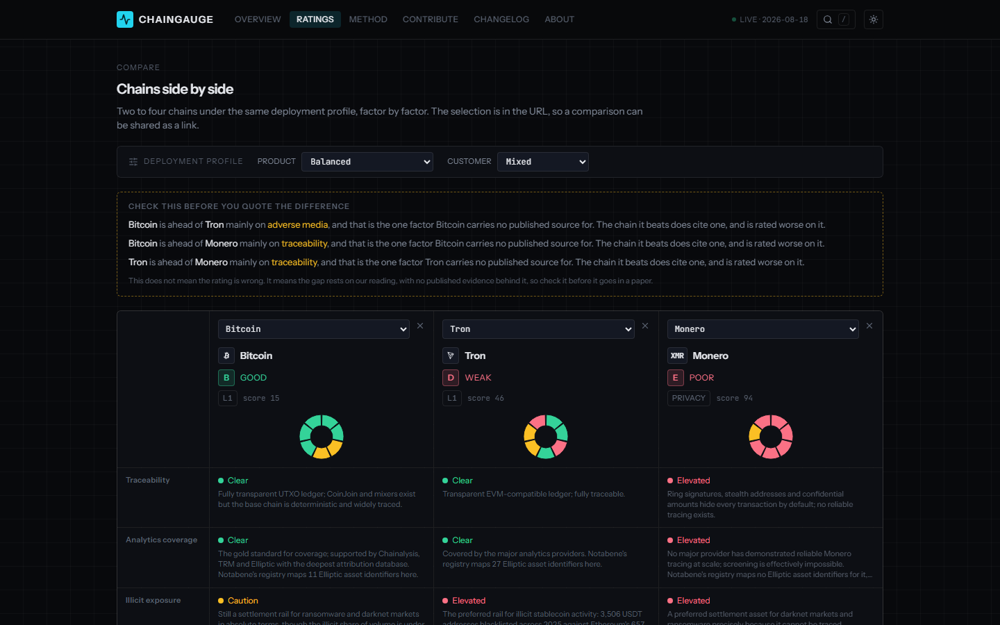
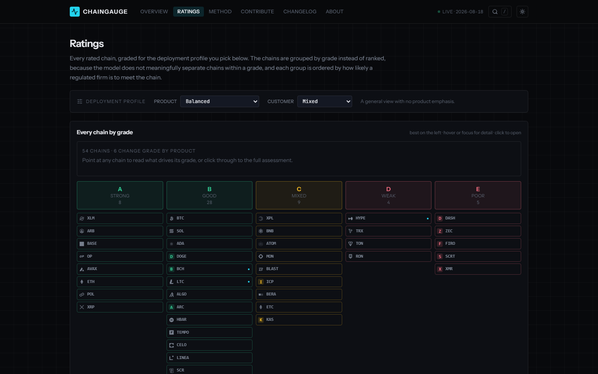
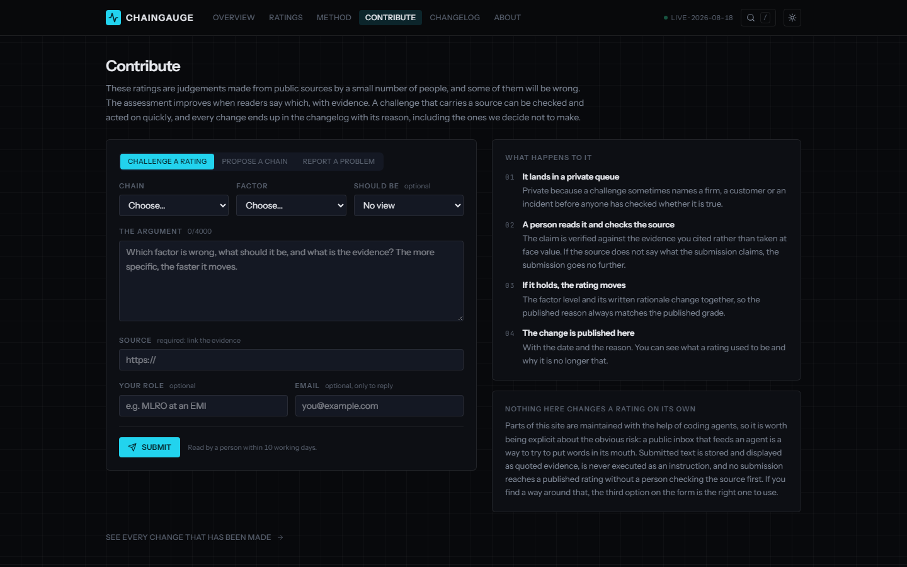

<div align="center" id="hero-image">
  <picture>
    <source srcset="docs/assets/overview-dark.png" media="(prefers-color-scheme: dark)">
    
  </picture>
</div>

<h1 align="center">ChainGauge</h1>

<p align="center">Financial crime ratings of 54 public blockchains for compliance teams.</p>

<p align="center">
  <a href="https://chaingauge.app">Live site</a> |
  <a href="https://chaingauge.app/ratings.json">Ratings feed</a> |
  <a href="https://chaingauge.app/#/method">Method</a> |
  <a href="LICENSE">Licence</a>
</p>

ChainGauge rates 54 public blockchains on 7 financial crime factors for compliance teams that assess a chain before a product team deploys on it. Each rating sets out its reasoning and cites the sources it relies on.

ChainGauge is a personal project of Sooraj Muhammed, a consultant in financial crime and digital assets and formerly a senior policy adviser on cryptoassets at the Financial Conduct Authority. The project has no employer involvement and no affiliation with any chain, analytics provider or vendor. No one pays to be listed or rated.

## What you can do

- See the grade of each chain for a product and a customer type that you choose.
- Open a chain page to read its 7 factors, its rationale and its sources.
- Put 2 to 4 chains side by side on the compare page.
- Read the risk matrix for all chains.
- Download a chain as JSON, or print it.
- Read the ratings feed in your own tools.
- Challenge a rating that you think is wrong.

## How it works

Each chain is rated on 7 factors:

- Traceability
- Analytics coverage
- Illicit exposure
- Asset controls
- Travel Rule and identity
- Accountability
- Adverse media

Each factor has one of 3 levels, Clear, Caution or Elevated. Green always means lower financial crime concern.

The 7 levels feed a weighted risk score from 0 (best) to 100 that maps to a letter grade from A to E. The weights depend on the deployment profile chosen from 6 products and 3 customer types. The posture band of Use it, Use it carefully or Think hard is derived from the grade by fixed rules and is never stored.

The basis that each rating states is observed where the point was measured and no record where there is too little history to say. A Clear level with a basis of no record reads as an absence of evidence. Each grade also shows the share of its weight that rests on a cited source.

<p align="center">
  
</p>

The risk matrix shows the level of every chain on every factor in one table.

<p align="center">
  
</p>

## Comparing chains

Choose 2 to 4 chains on the compare page to see their factors, grades and sources next to each other. The page also warns when one chain leads another only on a factor that has no published source.

<p align="center">
  
</p>

The ratings page groups all 54 chains by grade for the profile you choose. Each chain opens its own page from there.

<p align="center">
  
</p>

## Using the ratings in your own work

- The feed at `/ratings.json` carries schema version 2. It holds the raw factor levels, the reference profile, the weights and the review dates. It is regenerated on every build and served with an open `Access-Control-Allow-Origin` header.
- Each chain page has a JSON button and a Print / PDF button.
- The address of the compare page carries its selection of chains and can be shared as a link.

## Challenge a rating

The Contribute page takes a challenge to a factor, a proposal for a missing chain or a report of a defect from any reader without an account.

Submissions go to a private queue because a submission may name a firm or an incident before anyone has checked it. A person opens the cited source before any rating moves. Every change is published in the changelog with its date and reason. The steps are set out in `docs/CONTRIBUTIONS.md`.

<p align="center">
  
</p>

## How the evidence is kept current

Each Monday a scheduled coding agent reviews the evidence and proposes its changes as a pull request in the working repository. A second agent merges the pull request only where each new or changed claim matches its cited source. The maintainer may revert any change that a merge deploys to the site. The routines and their review standard are set out in `docs/WEEKLY-REFRESH.md`.

This repository is a public copy of the working repository and is refreshed from it. The live site and the feed carry the current ratings.

## Build from source

You need Node 22.12 or later and a copy of this repository. To run the site on your own computer, run these commands from the repository root:

```
cd web
npm install --legacy-peer-deps
npm run dev
```

The site then opens at `http://localhost:5177`. To run the checks, run these commands from the `web` folder:

```
npm test
npm run gates
```

The command `npm run gates` runs lint, tests, the prose check, the source check, the API type check, the build and the design check.

## Repository layout

- `web/` holds the site.
- `api/` holds the function that receives submissions.
- `tools/` holds the helper scripts.
- `docs/` holds the reference documents `ARCHITECTURE.md`, `CONTENT.md`, `CONTRIBUTIONS.md`, `DESIGN.md`, `METHODOLOGY.md`, `RED-TEAM.md`, `RUNBOOK.md` and `WEEKLY-REFRESH.md`.

## Scope and disclaimer

ChainGauge covers public chains only. The ratings are a curated and dated view of public information that does not update live. They are a starting point for enhanced due diligence and do not replace transaction screening. They are not legal, regulatory or investment advice.

## Licence and acknowledgements

ChainGauge is licensed under the Apache License, Version 2.0 (see `LICENSE`). The fonts in `web/public/fonts`, Instrument Sans and JetBrains Mono, are under the SIL Open Font License 1.1. The network glyphs in `web/src/content/chainIcons.ts` are generated from the package `@web3icons/core` under the MIT License. The names and logos of the networks are the marks of their owners and are used only to identify each network. Further details are in `NOTICE` and `THIRD_PARTY_NOTICES.md`. As the licence says, the software is provided 'as is', without warranties or conditions of any kind.

## Reporting a problem

Send a challenge to a rating through the Contribute page. Raise a bug in the code as an issue in this repository. Report a security problem privately, as `SECURITY.md` describes.
